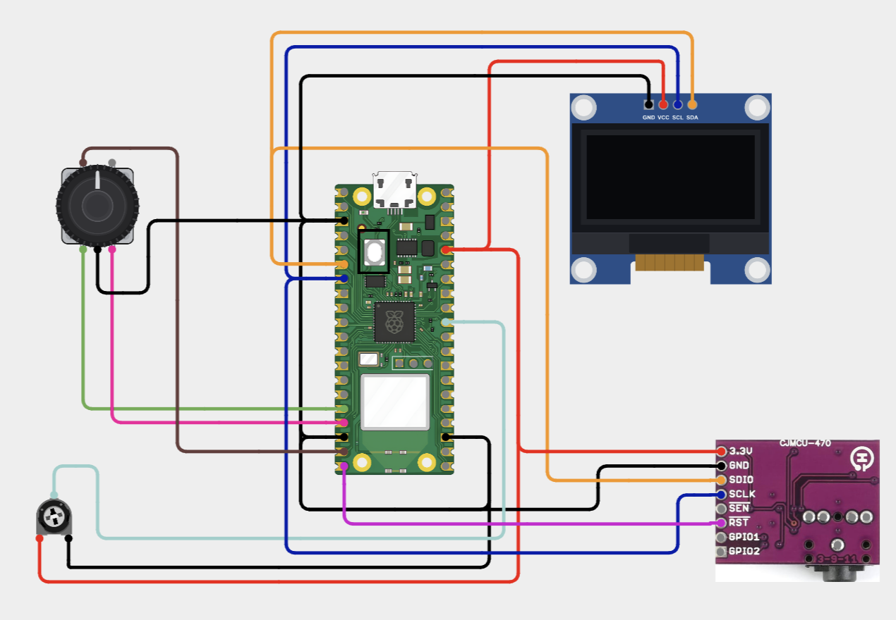

# FM Radio receiver with digital tuning 


[](LICENSE)

Projekt digitálně laděného FM přijímače založeného na mikrokontroléru **Raspberry Pi Pico** a rádiovém modulu **Si4703**. Zařízení umožňuje ladění stanic pomocí rotačního enkodéru, ukládání předvoleb a zobrazování provozních parametrů i RDS informací na grafickém displeji.

### Týmové rozdělení

| Člen týmu | Role a hlavní zaměření |
| :--- | :--- |
| **Jakub Dibelka** | Finální dokumentace projektu, demo video, ladění |
| **Martin Doucha** | Ladění programu v MicroPythonu, testování periferií |
| **Matěj Jurka** | Architektura a vývoj hlavního programu v MicroPythonu, ladění |


### Základní funkce
- **Příjem a demodulace FM** (Si4703) s výstupem do sluchátek nebo reproduktoru.
- **Digitální ladění** (87,5 – 108,0 MHz) pomocí rotačního enkodéru.
- **Ovládání hlasitosti a předvoleb** pomocí tlačítek či joysticku.
- **Zobrazení údajů na LCD:** frekvence, hlasitost, síla signálu (**RSSI**) a **RDS** (název stanice, RadioText).

## Obsah
- [Lab1: Proposal and architecture](#lab1-proposal-and-architecture)
- [Lab2: Device modules](#lab2-device-modules)
- [Lab3: System integration](#lab3-system-integration)


## Lab1: Proposal and architecture

V rámci prvního cvičení jsme rozdělili role v týmu, seznámili se s dostupnými hardwarovými moduly a navrhli základní blokovou architekturu celého systému.

### Použitý hardware
| Modul / součástka | Rozhraní | Účel v projektu |
| :--- | :---: | :--- |
| **Raspberry Pi Pico** | — | Hlavní řídicí mikrokontrolér (RP2040, MicroPython) |
| **Si4703 FM Tuner** | `I2C` | Příjem FM vysílání, demodulace audia a čtení RDS/RSSI |
| **LCD Nokia 5110 (PCD8544)** | `SPI` | Grafické zobrazení frekvence, hlasitosti, RSSI a RDS |
| **Rotační enkodér** | `GPIO` | Plynulé ladění frekvence a pohyb v menu |
| **Potenciometr B10K** | `ADC` / analog | Regulace hlasitosti (nebo nastavení kontrastu / vstupu) |
| **Tlačítka / Joystick** | `GPIO` | Výběr oblíbených stanic a potvrzování voleb |

### Blokové schéma


## Lab2: Device modules
Ověření funkčnost jednotlivých periferií samostatně před jejich spojením do finální aplikace.

### Schéma a tabulka zapojení (Pinout)

Všechny připojené moduly jsou napájeny z větve **3,3 V** a mají společnou zem **GND**.



| Modul | Pin modulu | Pin na Pico W | Fyzický pin | Poznámka / konfigurace |
| :--- | :---: | :---: | :---: | :--- |
| **OLED SH1106** | `SDA` | `GP4` | 6 | Sběrnice I2C (`SoftI2C` / `I2C0`), adresa `0x3C` |
| **OLED SH1106** | `SCL` | `GP5` | 7 | Sběrnice I2C (`SoftI2C` / `I2C0`) |
| **OLED SH1106** | `VCC` / `GND` | `3V3` / `GND` | 36 / 3 | Napájení 3,3 V |
| **Si4703 FM Tuner** | `SDIO` (`SDA`) | `GP4` | 6 | Sdílená sběrnice I2C, adresa `0x10` (při resetu v `LOW`) |
| **Si4703 FM Tuner** | `SCLK` (`SCL`) | `GP5` | 7 | Sdílená sběrnice I2C |
| **Si4703 FM Tuner** | `RST` | `GP15` | 20 | Reset pin pro přepnutí čipu do 2-wire (I2C) režimu |
| **Si4703 FM Tuner** | `3.3V` / `GND` | `3V3` / `GND` | 36 / 18 | Striktně 3,3 V |
| **Rotační enkodér** | `CLK` | `GP12` | 16 | Vstup `Pin.IN, Pin.PULL_UP`, IRQ (`hard=True`) |
| **Rotační enkodér** | `DT` | `GP13` | 17 | Vstup `Pin.IN, Pin.PULL_UP` |
| **Rotační enkodér** | `SW` (tlačítko) | `GP14` | 19 | Vstup `Pin.IN, Pin.PULL_UP`, spíná proti `GND` (aktivní `LOW`) |
| **Rotační enkodér** | `+` / `GND` | `3V3` / `GND` | 36 / 3 | Napájení 3,3 V (bezpečné pro logiku RP2040) |
| **Potenciometr** | `SIG` | `GP26` (`ADC0`) | 31 | Analogový vstup `0 – 3,3 V` |
| **Potenciometr** | `VCC` / `GND` | `3V3` / `GND` | 36 / 23 | Referenční napájení 3,3 V |


### Zamýšlené časování úloh (Task timing)

Časově kritické vstupy jsou řešeny přes přerušení (IRQ), ostatní periferie periodicky v hlavní smyčce pomocí `time.ticks_ms()` a `time.ticks_diff()`.

| Úloha (Task) | Způsob spouštění | Perioda / debounce | Popis činnosti |
| :--- | :---: | :---: | :--- |
| **Otáčení enkodéru (`CLK`/`DT`)** | Hardwarové IRQ (`hard=True`) | Debounce `2 ms` | Okamžité vyhodnocení směru a změna kroku |
| **Stisk tlačítka (`SW`)** | Softwarové IRQ (`IRQ_FALLING`) | Debounce `200 ms` | Nastavení pro přepnutí kroku ladění (`0,1` / `1,0 MHz`) |
| **Obsluha kroků a přeladění** | Hlavní smyčka | `20 ms` (`50 Hz`) | Vyčtení nastřádaných kroků, kontrola pásma a volání `set_channel()` |
| **Čtení potenciometru (hlasitost)** | Periodicky (`ticks_ms`) | `200 ms` (`5 Hz`) | Průměrování 10 vzorků ADC, volání `set_volume()` jen při změně |
| **Překreslení displeje** | Událostně / periodicky | Při změně / max. `500 ms` | Aktualizace frekvence, kroku, hlasitosti, RSSI a RDS |
| **Vyčítání RDS a RSSI** | Periodicky (`ticks_ms`) | `40 ms` / `1 s` | Kontrola příznaku `RDSR` v registru `STATUSRSSI` a aktualizace textu |

### Použité knihovny a prostředí

* **Verze MicroPythonu:** `MicroPython v1.2x.x` pro Raspberry Pi Pico W
* **Vestavěné moduly:** `machine` (`Pin`, `I2C`, `SoftI2C`, `ADC`), `framebuf`, `time`

| Soubor knihovny | Původ / autor | Popis a historie změn |
| :--- | :--- | :--- |
| `lib/sh1106_oled.py` | Převzato z výukových materiálů (DE2) | Ovladač OLED SH1106 (`SH1106_I2C`); doplněna funkce `update_display()` pro frekvenci a krok |
| `lib/rotary_encoder.py` | Vlastní implementace týmu | Obsluha enkodéru a tlačítka přes IRQ s debouncingem |
| `lib/si4703.py` | Adaptováno z knihovny SparkFun / datasheetu Si4703 | Ovládání registrů Si4703 přes I2C, nastavení pro evropské pásmo, hlasitost a RDS |
| `lib/potentiometer.py` | Vlastní implementace týmu | Čtení ADC (`GP26`), průměrování šumu a převod na rozsah hlasitosti `0 – 15` |

### Struktura programů v repozitáři
> [!NOTE]
> Navrhnutá struktora obsahuje programy, které ještě nejdou vloženy do repozitáře, ale budou v budoucnu vloženy.

```text
fm-radio-pico/
├── lib/
│   ├── sh1106_oled.py            # Ovladač OLED displeje SH1106
│   ├── rotary_encoder.py         # Obsluha rotačního enkodéru a tlačítka
│   ├── si4703.py                 # Ovladač FM tuneru Si4703
│   └── potentiometer.py          # Obsluha potenciometru (ADC)
├── tests/
│   ├── dislay_oled.py            # Samostatný test OLED displeje
│   ├── rotary_encoder.py         # Samostatný test enkodéru
│   ├── potentiometer.py          # Samostatný test potenciometru
│   └── si4703Library.py          # Samostatný test FM modulu
├── main.py                       # Finální program
├── LICENSE
└── README.md
```

## Lab3: System integration
Sloučení samostatně otestovaných modulů do jednoho hlavního programu (`main.py`) a ověření jejich společné komunikace v reálném provozu.

### Integrace periferií do hlavního programu
- [ ] **Sdílená I2C sběrnice:** Správné nastavení (reset Si4703 před spuštěním OLED SH1106 na `GP4`/`GP5`).
- [ ] **Ladění a ovládání:** Propojení rotačního enkodéru s přelaďováním Si4703 a přepínáním kroku (`0,1` / `1,0 MHz`).
- [ ] **Řízení hlasitosti:** Periodické čtení potenciometru (`GP26`) a aktualizace hlasitosti tuneru bez blokování smyčky.
- [ ] **Uživatelské rozhraní:** Vykreslování aktuální frekvence, kroku, hlasitosti, RSSI a RDS na OLED displeji.

### Architektura hlavního programu (`main.py`)

### Finální zapojení a testování celku
