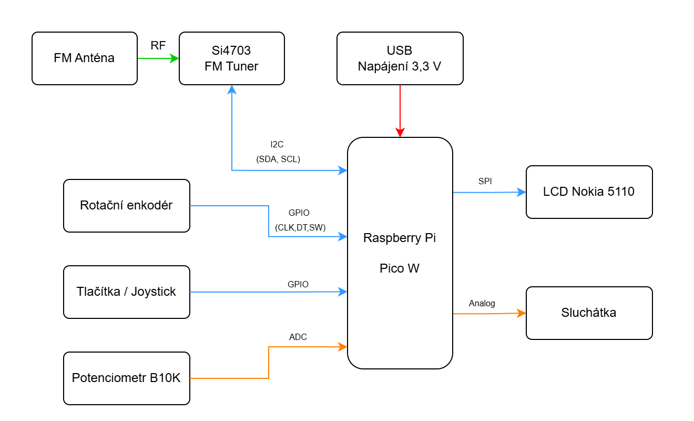

# FM Radio receiver with digital tuning 

Projekt digitálně laděného FM přijímače založeného na mikrokontroléru **Raspberry Pi Pico** a rádiovém modulu **Si4703**. Zařízení umožňuje ladění stanic pomocí rotačního enkodéru, ukládání předvoleb a zobrazování provozních parametrů i RDS informací na grafickém displeji.

### Týmové rozdělení

| Člen týmu | Role a hlavní zaměření |
| :--- | :--- |
| **Jakub Dibelka** | Finální dokumentace projektu, demo video, ladění |
| **Martin Doucha** | Ladění programu v MicroPythonu, testování periferií |
| **Matěj Jurka** | Architektura a vývoj hlavního programu v MicroPythonu, ladění |

### Základní funkce
- **Příjem a demodulace FM** (Si4703) s výstupem do sluchátek nebo reproduktoru.
- **Digitální ladění** (xx – xxx MHz) pomocí rotačního enkodéru.
- **Ovládání hlasitosti a předvoleb** pomocí tlačítek či joysticku.
- **Zobrazení údajů na LCD:** frekvence, hlasitost, síla signálu (**RSSI**) a **RDS** (název stanice, RadioText).

## Obsah
* [Lab1: Proposal and architecture](#lab1-proposal-and-architecture)
* [Lab2: Device modules](#lab2-device-modules)

## Lab1: Proposal and architecture

V rámci prvního cvičení jsme rozdělili role v týmu, seznámili se s dostupnými hardwarovými moduly a navrhli základní blokovou architekturu celého systému.

### Použitý hardware
| Modul / součástka | Rozhraní | Účel v projektu |
| :--- | :---: | :--- |
| **Raspberry Pi Pico** | — | Hlavní řídicí mikrokontrolér (RP2040, MicroPython) |
| **Si4703 FM Tuner** | `I2C` | Příjem FM vysílání, demodulace audia a čtení RDS/RSSI |
| **LCD Nokia 5110 (PCD8544)** | `SPI` | Grafické zobrazení frekvence, hlasitosti, RSSI a RDS |
| **Rotační enkodér** | `GPIO` | Plynulé ladění frekvence a pohyb v menu |
| **Potenciometr B10K** | `ADC` / analog | Regulace hlasitosti (nebo nastavení kontrastu / vstupu) |
| **Tlačítka / Joystick** | `GPIO` | Výběr oblíbených stanic a potvrzování voleb |

### Blokové schéma
> [!NOTE]
> Níže uvedené blokové schéma je pracovní verze a zatím neobsahuje přiřazení GPIO pinů ani napájecí větve.

## Lab2: Device modules
Ověření funkčnost jednotlivých periferií samostatně před jejich spojením do finální aplikace.

### Testování senzorů a periferií
- [ ] **Si4703:** Inicializace, naladění testovací stanice, vyčtení RSSI a RDS.
- [ ] **Nokia 5110 LCD:** Vykreslení základního textu a ukazatele síly signálu přes SPI.
- [ ] **Rotační enkodér a tlačítka:** Ošetření zákmitů (debouncing) a čtení směru otáčení.

### Tabulka zapojení (Pinout)

